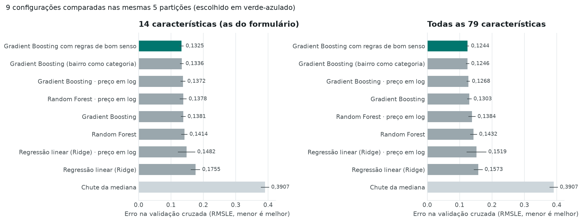
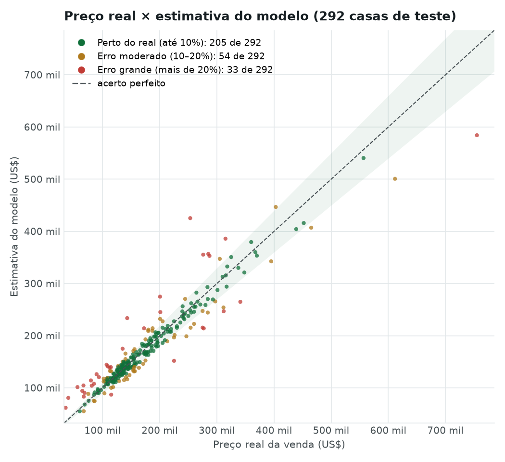
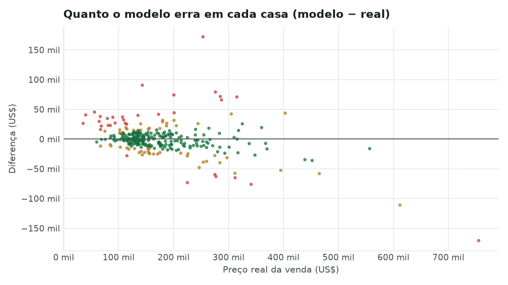
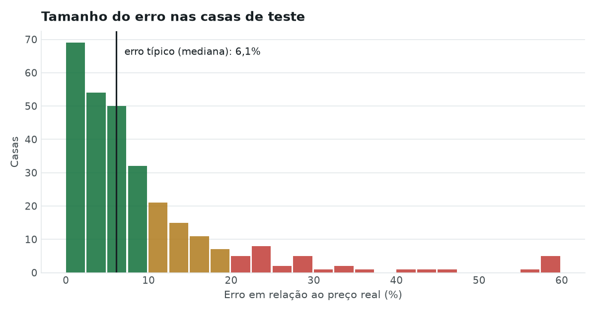
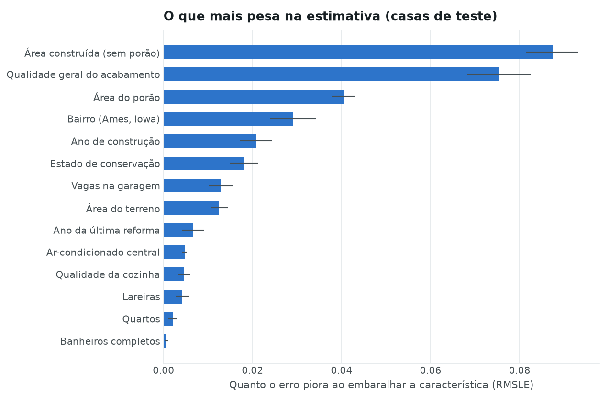
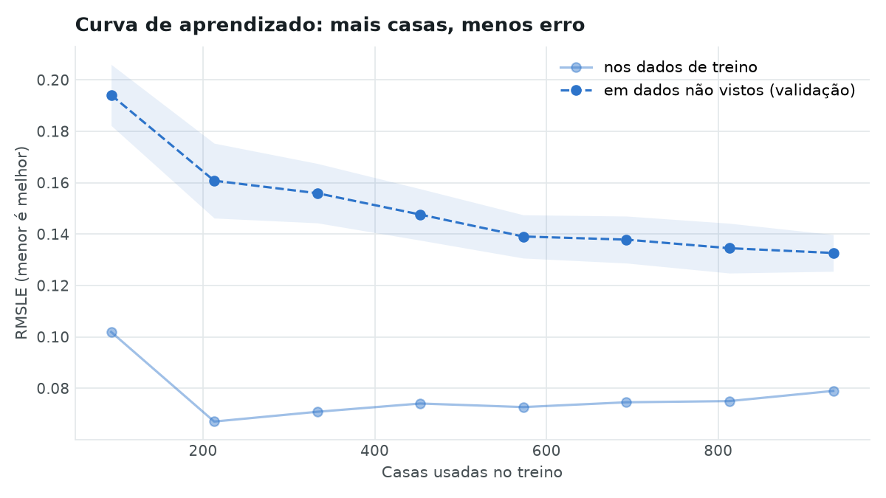
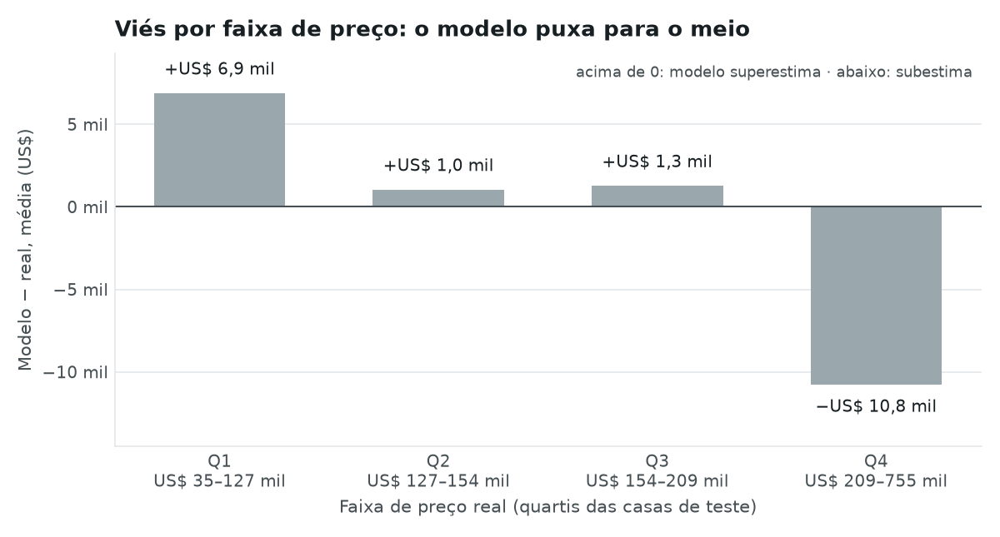

# Avaliação dos modelos — HouseValue AI

> Gerado por `python -m ml.build_docs` a partir de `artifacts/metrics/`. Protocolo em `docs/methodology.md`.

## 1. Métrica primária (definida antes dos experimentos)
**RMSLE**, para alinhamento com a métrica da competição Kaggle (RMSE entre logaritmos), com desempate por **MAE em USD**. MAE, RMSE e R² também são reportados. Todas as métricas abaixo estão em USD/escala original, calculadas nos mesmos dados para todos os modelos.

## 2. Validação cruzada — conjunto da aplicação (14 variáveis)
5 folds, mesma partição para todos; desenvolvimento = 1168 imóveis. ★ = selecionado.

| Configuração | RMSLE CV | ± dp | MAE CV | RMSE CV | R² CV | RMSLE treino | Hiperparâmetros |
|---|---|---|---|---|---|---|---|
| HistGradientBoosting (nativo, monotônico) + log1p(y) ★ | 0,1325 | 0,0068 | US$ 16.747 | US$ 26.279 | 0,884 | 0,0786 | learning_rate=0.03, max_leaf_nodes=15 |
| HistGradientBoosting (categorias nativas) + log1p(y) | 0,1336 | 0,0054 | US$ 16.956 | US$ 27.234 | 0,875 | 0,0886 | learning_rate=0.03, max_leaf_nodes=7 |
| HistGradientBoosting + log1p(y) | 0,1372 | 0,0073 | US$ 17.203 | US$ 28.704 | 0,861 | 0,0939 | learning_rate=0.03, max_leaf_nodes=7 |
| RandomForest + log1p(y) | 0,1378 | 0,0106 | US$ 17.404 | US$ 29.783 | 0,850 | 0,0516 | max_features=0.33, min_samples_leaf=1 |
| HistGradientBoosting | 0,1381 | 0,0070 | US$ 17.325 | US$ 28.581 | 0,863 | 0,1005 | learning_rate=0.03, max_leaf_nodes=7 |
| RandomForest | 0,1414 | 0,0097 | US$ 17.371 | US$ 29.165 | 0,856 | 0,0576 | max_features=0.33, min_samples_leaf=1 |
| Ridge + log1p(y) | 0,1482 | 0,0268 | US$ 18.575 | US$ 41.491 | 0,607 | 0,1391 | alpha=3 |
| Ridge | 0,1755 | 0,0146 | US$ 24.185 | US$ 39.730 | 0,734 | 0,1742 | alpha=1000 |
| Dummy | 0,3907 | 0,0128 | US$ 54.573 | US$ 78.872 | -0,046 | 0,3908 | — |

## 3. Validação cruzada — todos os 79 atributos (referência)

| Configuração | RMSLE CV | ± dp | MAE CV | RMSE CV | R² CV | RMSLE treino | Hiperparâmetros |
|---|---|---|---|---|---|---|---|
| HistGradientBoosting (nativo, monotônico) + log1p(y) ★ | 0,1244 | 0,0047 | US$ 15.315 | US$ 25.153 | 0,894 | 0,0403 | learning_rate=0.03, max_leaf_nodes=15 |
| HistGradientBoosting (categorias nativas) + log1p(y) | 0,1246 | 0,0049 | US$ 15.249 | US$ 25.890 | 0,887 | 0,0664 | learning_rate=0.03, max_leaf_nodes=7 |
| HistGradientBoosting + log1p(y) | 0,1268 | 0,0051 | US$ 15.467 | US$ 26.253 | 0,884 | 0,0365 | learning_rate=0.1, max_leaf_nodes=7 |
| HistGradientBoosting | 0,1303 | 0,0065 | US$ 16.089 | US$ 26.966 | 0,878 | 0,0431 | learning_rate=0.1, max_leaf_nodes=7 |
| RandomForest + log1p(y) | 0,1384 | 0,0109 | US$ 16.881 | US$ 29.926 | 0,849 | 0,0523 | max_features=0.33, min_samples_leaf=1 |
| RandomForest | 0,1432 | 0,0109 | US$ 17.054 | US$ 29.492 | 0,853 | 0,0587 | max_features=0.33, min_samples_leaf=1 |
| Ridge + log1p(y) | 0,1519 | 0,0306 | US$ 17.750 | US$ 48.661 | 0,431 | 0,1117 | alpha=30 |
| Ridge | 0,1573 | 0,0138 | US$ 20.824 | US$ 36.953 | 0,768 | 0,1479 | alpha=1000 |
| Dummy | 0,3907 | 0,0128 | US$ 54.573 | US$ 78.872 | -0,046 | 0,3908 | — |

### Leitura dos resultados de CV
- Todos os modelos superam o baseline por ampla margem (RMSLE do baseline: 0,3907).
- A transformação `log1p(y)` reduziu a RMSLE em todos os algoritmos nos dois conjuntos.
- Os modelos de árvores (Random Forest e HistGradientBoosting) tiveram RMSLE menor que o Ridge. Isso é compatível com a hipótese H2 (relações não lineares), mas a diferença entre RF e HGB no conjunto da aplicação é pequena, da ordem do desvio-padrão entre folds.
- **Instabilidade do Ridge + log1p(y):** apesar da RMSLE razoável, o RMSE e o R² médios são ruins por causa de um fold: RMSE por fold (conjunto full) = [41724, 23622, 21052, 117156, 39753], R² por fold = [0.717, 0.898, 0.911, -1.141, 0.768] (conjunto app: R² = [0.753, 0.901, 0.869, -0.396, 0.908]). Em escala log, um modelo linear extrapola de forma exponencial para imóveis atípicos (ex.: áreas muito grandes), e `expm1` amplifica o erro em USD.
- Treino × validação: o HGB selecionado tem RMSLE de treino 0,0786 contra 0,1325 na validação — há ajuste aos dados de treino, esperado em boosting, mas a validação permanece a melhor entre os candidatos. Ver `artifacts/figures/eval_train_vs_validation.png`.

## 4. Modelo selecionado
- **Aplicação:** `HistGradientBoostingRegressor (nativo, monotônico) + log1p(y)` com learning_rate=0.03, max_leaf_nodes=15.
- **Referência full:** `HistGradientBoostingRegressor (nativo, monotônico) + log1p(y)`.
- Reajustado na partição de desenvolvimento inteira (1168 imóveis). O artefato avaliado abaixo é o mesmo arquivo carregado pela API (SHA-256 `e75046fbc0f03cc16e1b5aa4a145d6a455a85d6082fbd3c036468bb708372eb5`).

## 5. Holdout (292 imóveis, avaliação única)

| Artefato | Configuração | RMSLE | MAE | RMSE | R² |
|---|---|---|---|---|---|
| Aplicação (14 variáveis) ★ | HistGradientBoosting (nativo, monotônico) + log1p(y) | 0,1367 | US$ 16.298 | US$ 26.766 | 0,907 |
| Referência (79 variáveis) | HistGradientBoosting (nativo, monotônico) + log1p(y) | 0,1334 | US$ 15.499 | US$ 26.968 | 0,905 |
| Baseline | DummyRegressor (mediana) | 0,4323 | US$ 59.568 | US$ 88.667 | -0,025 |

Supera o baseline em todas as métricas: **sim** (aplicação); referência full: **sim**.

### CV × holdout (modelo da aplicação)

| Métrica | CV (média ± dp) | Holdout |
|---|---|---|
| RMSLE | 0,1325 ± 0,0068 | 0,1367 |
| MAE | US$ 16.747 ± US$ 687 | US$ 16.298 |
| RMSE | US$ 26.279 ± US$ 2.781 | US$ 26.766 |
| R² | 0,884 ± 0,014 | 0,907 |

A RMSLE do holdout é próxima da CV (dentro de ~1 dp), indicando que a estimativa de CV não foi muito otimista. O R² do holdout é maior que o da CV; uma explicação compatível com os dados é que os dois imóveis anômalos com `GrLivArea` > 4.000 pés² (≈ 372 m²) e preço baixo (Ids 524 e 1299) ficaram na partição de desenvolvimento, não no holdout, e esses casos pesam mais no RMSE/R² do que na RMSLE. Com 292 imóveis, o holdout também tem variância amostral.

O conjunto completo (79 variáveis) teve RMSLE menor no holdout (0,1334 vs 0,1367), mas RMSE maior (US$ 26.968 vs US$ 26.766). O ganho de usar 79 variáveis em vez de 14 é pequeno nesta base; o modelo de 14 variáveis é o usado na aplicação porque o usuário consegue preenchê-las.

## 6. Diagnóstico de resíduos (aplicação, holdout)
- Resíduo médio (real − previsto): US$ 354; mediana: US$ 980.
- Erro absoluto mediano: US$ 9.909; 90% dos imóveis com erro até US$ 37.226.
- Erro percentual médio (MAPE): 9,7%; mediano: 6,1%.

Os imóveis mais caros tendem a ser subestimados (pontos abaixo da diagonal na faixa alta): há poucos exemplos acima de US$ 400 mil para aprender esse trecho.

### Maiores erros absolutos

| Id | Real | Previsto | |Erro| | Erro % | Área construída | OverallQual | Bairro | SaleCondition |
|---|---|---|---|---|---|---|---|---|
| 582 | US$ 253.293 | US$ 425.313 | US$ 172.020 | 67,9% | 190 m² | 8 | NridgHt | Partial |
| 692 | US$ 755.000 | US$ 584.212 | US$ 170.788 | 22,6% | 401 m² | 10 | NoRidge | Normal |
| 899 | US$ 611.657 | US$ 500.697 | US$ 110.960 | 18,1% | 220 m² | 9 | NridgHt | Partial |
| 589 | US$ 143.000 | US$ 233.657 | US$ 90.657 | 63,4% | 137 m² | 5 | ClearCr | Partial |
| 262 | US$ 276.000 | US$ 355.313 | US$ 79.313 | 28,7% | 239 m² | 8 | CollgCr | Partial |
| 719 | US$ 341.000 | US$ 264.909 | US$ 76.091 | 22,3% | 225 m² | 7 | NoRidge | Normal |
| 1174 | US$ 200.500 | US$ 274.813 | US$ 74.313 | 37,1% | 287 m² | 5 | ClearCr | Normal |
| 608 | US$ 225.000 | US$ 151.805 | US$ 73.195 | 32,5% | 187 m² | 5 | Edwards | Normal |
| 1176 | US$ 285.000 | US$ 356.678 | US$ 71.678 | 25,1% | 267 m² | 8 | NoRidge | Normal |
| 424 | US$ 315.000 | US$ 385.952 | US$ 70.952 | 22,5% | 244 m² | 8 | NoRidge | Normal |
| 1025 | US$ 287.000 | US$ 352.943 | US$ 65.943 | 23,0% | 269 m² | 8 | Timber | Abnorml |
| 197 | US$ 311.872 | US$ 246.814 | US$ 65.058 | 20,9% | 160 m² | 7 | Somerst | Partial |
| 209 | US$ 277.000 | US$ 214.009 | US$ 62.991 | 22,7% | 192 m² | 7 | SawyerW | Normal |
| 427 | US$ 275.000 | US$ 215.455 | US$ 59.545 | 21,6% | 153 m² | 7 | SawyerW | Normal |
| 1244 | US$ 465.000 | US$ 407.013 | US$ 57.987 | 12,5% | 193 m² | 10 | NridgHt | Partial |

Condição de venda entre os 15 maiores erros: Partial: 6, Normal: 8, Abnorml: 1. No treino, `Partial` (venda de imóvel novo/inacabado) representa 8,6% das vendas — está sobrerrepresentada entre os maiores erros. `SaleCondition` não está no formulário por não descrever o imóvel.

## 7. Importância das variáveis (aplicação)
Importância por permutação no holdout (aumento da RMSLE ao embaralhar cada coluna, 20 repetições). Não é causalidade; variáveis correlacionadas dividem importância.

| Variável | Aumento da RMSLE (média) | dp |
|---|---|---|
| GrLivArea | 0,0874 | 0,0058 |
| OverallQual | 0,0754 | 0,0072 |
| TotalBsmtSF | 0,0404 | 0,0027 |
| Neighborhood | 0,0291 | 0,0052 |
| YearBuilt | 0,0207 | 0,0036 |
| OverallCond | 0,0181 | 0,0032 |
| GarageCars | 0,0128 | 0,0026 |
| LotArea | 0,0125 | 0,0020 |
| YearRemodAdd | 0,0066 | 0,0025 |
| CentralAir | 0,0047 | 0,0005 |
| KitchenQual | 0,0047 | 0,0013 |
| Fireplaces | 0,0042 | 0,0015 |
| BedroomAbvGr | 0,0021 | 0,0011 |
| FullBath | 0,0007 | 0,0003 |

`OverallCond` teve associação univariada fraca na triagem, mas importância por permutação relevante: o efeito aparece condicionado às demais variáveis (ex.: mesma idade/qualidade). `FullBath` e `BedroomAbvGr` contribuem pouco quando a área já está presente.

## 8. Conclusão sobre as hipóteses
- **H1** (características associadas ao preço): suportada — correlações fortes na EDA e modelos com RMSLE ~0,14 contra 0,43 do baseline no holdout.
- **H2** (não linear > linear): suportada nesta base — árvores tiveram RMSLE menor que o Ridge em CV nos dois conjuntos, e o Ridge+log mostrou instabilidade em imóveis atípicos.
- **H3** (desempenhos distintos): suportada entre famílias (baseline ≪ Ridge < árvores); entre RF e HGB a diferença é pequena e não deve ser superinterpretada.
- **H4** (implantação sem alterar o pré-processamento): suportada — o mesmo `.joblib` é carregado pela API; teste automatizado confirma previsão idêntica (`tests/test_api.py::test_predict_matches_saved_pipeline`).

## 9. Limitações
- Ames, Iowa, 2006–2010, USD nominal: não generaliza para o Brasil nem para preços atuais.
- Erros maiores em imóveis caros, muito grandes ou vendas `Partial`/`Abnorml`.
- Sem intervalo de previsão calibrado — a aplicação não exibe faixa de preço.
- Holdout de 292 imóveis: as métricas têm incerteza amostral.
- A `submission.csv` (Kaggle) não foi avaliada localmente: `test.csv` não tem rótulos.

## 10. Versão 2 do experimento

A v2 manteve o protocolo (mesma partição, mesmos folds, mesma regra de seleção) e acrescentou dois candidatos de HistGradientBoosting: um com **categorias nativas** (OrdinalEncoder + `categorical_features`, sem one-hot; o HGB trata ausentes nativamente) e outro com as mesmas categorias nativas e **restrições monotônicas** crescentes (OverallQual, OverallCond, GrLivArea, TotalBsmtSF, LotArea, GarageCars, Fireplaces e FullBath; não em BedroomAbvGr nem nos anos). Só a variante com `log1p(y)` foi testada, porque o log venceu em todos os algoritmos da v1.

| Versão | Modelo escolhido (aplicação) | RMSLE CV | RMSLE holdout | MAE holdout | RMSE holdout | R² holdout |
|---|---|---|---|---|---|---|
| v1.0.0 | HistGradientBoosting + log1p(y) | 0,1372 | 0,1390 | US$ 16.668 | US$ 28.228 | 0,896 |
| v2.0.0 | HistGradientBoosting (nativo, monotônico) + log1p(y) | 0,1325 | 0,1367 | US$ 16.298 | US$ 26.766 | 0,907 |

**Ressalva metodológica:** o holdout já tinha sido consultado uma vez na v1. A v2 escolheu o modelo só pela validação cruzada, mas o holdout deixou de ser totalmente inédito para este projeto; os resultados da v1 estão preservados em `artifacts/history/v1/`.

### Holdout de cada candidato (informativo)

Calculado depois da seleção, não usado para escolher o modelo. Alimenta o painel "Algoritmos lado a lado" do simulador.

| Configuração | RMSLE CV | RMSLE holdout | MAE holdout | Selecionado |
|---|---|---|---|---|
| HistGradientBoosting (nativo, monotônico) + log1p(y) | 0,1325 | 0,1367 | US$ 16.298 | sim |
| HistGradientBoosting (categorias nativas) + log1p(y) | 0,1336 | 0,1392 | US$ 16.746 |  |
| HistGradientBoosting + log1p(y) | 0,1372 | 0,1390 | US$ 16.668 |  |
| RandomForest + log1p(y) | 0,1378 | 0,1445 | US$ 16.912 |  |
| HistGradientBoosting | 0,1381 | 0,1437 | US$ 17.378 |  |
| RandomForest | 0,1414 | 0,1482 | US$ 16.854 |  |
| Ridge + log1p(y) | 0,1482 | 0,1419 | US$ 17.478 |  |
| Ridge | 0,1755 | 0,1815 | US$ 24.908 |  |
| Dummy | 0,3907 | 0,4323 | US$ 59.568 |  |

## 11. Vencedor ou empate?

Os dois melhores do conjunto da aplicação, **HistGradientBoosting (nativo, monotônico) + log1p(y)** e **HistGradientBoosting (categorias nativas) + log1p(y)**, foram comparados com os hiperparâmetros fixos em 20 partições (RepeatedKFold 5 × 4) da partição de desenvolvimento. RMSLE médio: 0,1320 × 0,1328. O primeiro venceu em 16 de 20 partições; diferença média 0,0008 ± 0,0020. Veredito: **empate técnico** (Empate técnico quando |diferença média| < desvio-padrão das diferenças entre partições.)

No conjunto completo, com as diferenças pareadas dos 5 folds do treino: HistGradientBoosting (nativo, monotônico) + log1p(y) × HistGradientBoosting (categorias nativas) + log1p(y), o primeiro venceu 3 de 5 folds; diferença 0,0002 ± 0,0013 → empate técnico.

## 12. Curva de aprendizado

| Imóveis no treino | RMSLE treino | RMSLE validação |
|---|---|---|
| 93 | 0,1019 | 0,1941 |
| 213 | 0,0671 | 0,1608 |
| 333 | 0,0709 | 0,1559 |
| 453 | 0,0741 | 0,1476 |
| 573 | 0,0727 | 0,1391 |
| 693 | 0,0746 | 0,1379 |
| 813 | 0,0750 | 0,1345 |
| 934 | 0,0790 | 0,1327 |

## 13. Onde o modelo erra (holdout)

viés = média de (real − previsto). Positivo: o modelo subestima; negativo: superestima.

**Faixa de preço real**

| Segmento | n | MAE | MAPE | Viés médio |
|---|---|---|---|---|
| Q1: US$ 35–127 mil | 75 | US$ 11.944 | 14,5% | −US$ 6.879 |
| Q2: US$ 127–154 mil | 71 | US$ 9.671 | 6,9% | −US$ 1.037 |
| Q3: US$ 154–209 mil | 73 | US$ 13.499 | 7,5% | −US$ 1.265 |
| Q4: US$ 209–755 mil | 73 | US$ 30.016 | 9,7% | +US$ 10.758 |

**Condição de venda**

| Segmento | n | MAE | MAPE | Viés médio |
|---|---|---|---|---|
| Alloca | 5 | US$ 30.900 | 34,9% | −US$ 30.900 |
| Family | 2 | US$ 24.928 | 18,5% | −US$ 24.928 |
| Abnorml | 24 | US$ 15.676 | 15,9% | −US$ 12.071 |
| Partial | 27 | US$ 35.215 | 13,5% | +US$ 3.133 |
| Normal | 234 | US$ 13.793 | 8,0% | +US$ 2.192 |

**Bairro (n ≥ 8)**

| Segmento | n | MAE | MAPE | Viés médio |
|---|---|---|---|---|
| IDOTRR | 11 | US$ 20.435 | 34,7% | −US$ 12.926 |
| ClearCr | 9 | US$ 27.864 | 15,8% | −US$ 20.747 |
| NoRidge | 8 | US$ 61.080 | 15,0% | +US$ 7.366 |
| Edwards | 13 | US$ 16.985 | 13,4% | −US$ 407 |
| OldTown | 22 | US$ 10.593 | 11,6% | −US$ 4.144 |
| NridgHt | 16 | US$ 38.136 | 11,5% | +US$ 11.773 |
| Mitchel | 9 | US$ 14.016 | 10,5% | −US$ 2.291 |
| BrkSide | 13 | US$ 11.679 | 10,0% | −US$ 1.296 |
| Timber | 10 | US$ 24.681 | 9,9% | −US$ 14.100 |
| SawyerW | 15 | US$ 17.943 | 8,3% | +US$ 9.327 |
| CollgCr | 35 | US$ 13.886 | 6,7% | +US$ 1.634 |
| Sawyer | 16 | US$ 8.291 | 6,6% | −US$ 2.902 |
| NAmes | 44 | US$ 8.323 | 6,1% | +US$ 1.541 |
| Somerst | 17 | US$ 13.426 | 6,1% | +US$ 4.272 |
| Gilbert | 14 | US$ 10.244 | 5,9% | −US$ 1.898 |

Leitura: o modelo puxa as estimativas para o meio da distribuição: na faixa mais barata o viés médio é −US$ 6.879 e na mais cara +US$ 10.758 (regressão à média). A condição de venda não é uma entrada do modelo, por isso vendas atípicas erram mais.

## 14. Faixa típica de erro (80%)

Quantis 10% e 90% de log(real) − log(previsto) em previsões fora da amostra (cross_val_predict, KFold 5, seed 42) na partição de desenvolvimento. Fatores: previsto × [0,873, 1,150]. Conferência no holdout (292 casas, não usado na estimativa): o preço real caiu dentro da faixa em **79,1%** dos casos (nível nominal 80%). Dentro de ±10%: 65,2% fora da amostra no desenvolvimento e 70,2% no holdout.
